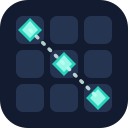

<div align="center">
  
  <h1>Match3-Board</h1>
  <p><strong>A configurable match-3 gameplay toolkit for Godot 4.7.</strong></p>
  <p>Build boards from Resources. Customize movement, presentation and game reactions without forking the plugin.</p>
  <p><a href="https://github.com/sempitern0/match3-board/blob/main/LICENSE">MIT License</a> · <a href="https://github.com/sempitern0/match3-board/issues">Issues</a> · <a href="docs/CUSTOMIZATION.md">Customization</a> · <a href="docs/EVENTS_AND_REACTIONS.md">Events</a></p>
</div>


## Features

- **Nine movement modes:** adjacent, adjacent + diagonals, diagonal-only, free, row, column, cross, diagonal cross, and line connection.
- **Three input styles:** click, drag and slide.
- **Three refill modes:** downward gravity, lateral gravity (Side) and in-place replacement.
- **Matching rules:** horizontal, vertical, T/L patterns, optional diagonals, minimum match length and special piece spawn rules.
- **Visual customization:** scenes for cells/pieces, pluggable animator, customizable highlighter, editor preview and Resource movement adapter.
- **Integration:** native Godot signals, typed `Match3BoardEvent` contexts and optional `Match3Reaction` Resources for audio, animations and scene callbacks.
- No autoloads, no required external dependencies.

## Installation

Copy the [`addons/match3/`](addons/match3) folder into your Godot project's `res://addons/match3/` directory. Enable **Match3-Board** in **Project → Project Settings → Plugins**.

**Try the complete demo:** open [`addons/match3/demo/demo.tscn`](addons/match3/demo/demo.tscn). It demonstrates the existing gameplay modes, animations, selection and highlighting. Demo scripts and assets are reference examples, not mandatory for a minimal integration.

## Quick start

1. Add a `Match3Board` Node2D to your scene.
2. Create and assign a `Match3BoardConfiguration` Resource.
3. Assign `grid_cell_scene` (root `Match3GridCell`) and at least two `Match3PieceConfiguration` entries in `available_pieces`, each pointing to a `Match3Piece` scene with a unique ID and a `Match3PieceWeight`.
4. Choose a movement mode, selection mode and fill mode. Keep `auto_start` enabled, or call `await board.start_board()` yourself.
5. Optionally add `Match3Animator`, `Match3Highlighter` and `Match3LineConnector` child nodes and assign them to the board (the connector is required for `ConnectLine` mode).

```gdscript
extends Node2D

@onready var board: Match3Board = $Match3Board

func _ready() -> void:
    board.consumed_sequence.connect(_on_match)
    board.swap_rejected.connect(_on_rejected_swap)

func _on_match(sequence: Match3Sequence) -> void:
    print("Matched %d pieces" % sequence.size())

func _on_rejected_swap(_from: Match3GridCell, _to: Match3GridCell) -> void:
    print("Invalid match")

func valid_destinations(from_cell: Match3GridCell) -> Array[Match3GridCell]:
    return board.get_valid_swap_targets(from_cell)
```

## Public API

| API | Purpose |
|---|---|
| `start_board()` | Initialize manually when auto-start is disabled |
| `get_cell(column, row)` | Access a grid cell |
| `get_matches()` | Find matching sequences |
| `can_swap_cells(from, to)` | Pure validity check |
| `get_valid_swap_targets(cell)` | Find allowed destinations, including custom movement adapter rules |
| `swap_pieces(from_piece, to_piece)` | Request an animated or immediate swap |
| `shuffle()` | Shuffle the board |
| `lock()` / `unlock()` | Toggle interaction |

Use signals such as `state_changed`, `swap_accepted`, `swap_rejected`, `consumed_sequence`, `drawed_pieces`, `selected_piece` and `finished_available_movements`. For structured event context, use `event_emitted`.

## Extending your game

| What to customize | Extension point |
|---|---|
| Rules, pieces and board geometry | `Match3BoardConfiguration`, `Match3PieceConfiguration`, `Match3PieceWeight` |
| Swap restrictions | `Match3MovementAdapter` Resource |
| Tile/gem appearance and special logic | `Match3GridCell` and `Match3Piece` scenes/scripts |
| Highlights | `Match3Highlighter` subclass |
| Transitions and tweens | `Match3Animator` subclass |
| UI, SFX, VFX and game-specific actions | `Match3Reaction` Resources or native signals |

**Guides:** [Full customization, every animator hook and settings](docs/CUSTOMIZATION.md) · [Events, reactive audio/animation and method calls](docs/EVENTS_AND_REACTIONS.md).

## Development & compatibility

Godot **4.7.2** is the CI target. To execute the headless regressions:

```sh
python3 scripts/ci/run_tests.py --godot godot
```

The suite checks movement rules, diagonal/gravity behavior and the event/reaction API. See [GitHub Actions](https://github.com/sempitern0/match3-board/actions) for the status of each commit. This plugin is maintained by [sempitern0](https://github.com/sempitern0) and licensed under [MIT](LICENSE).
